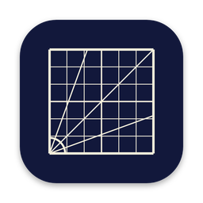
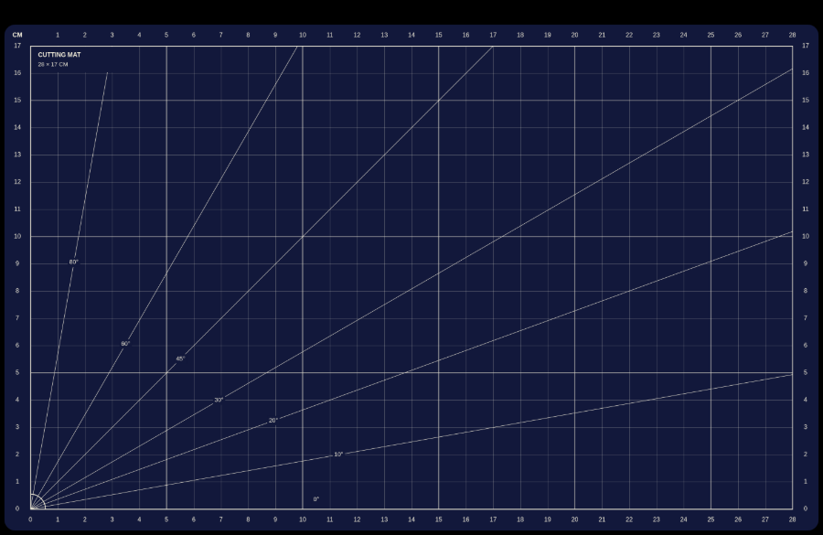
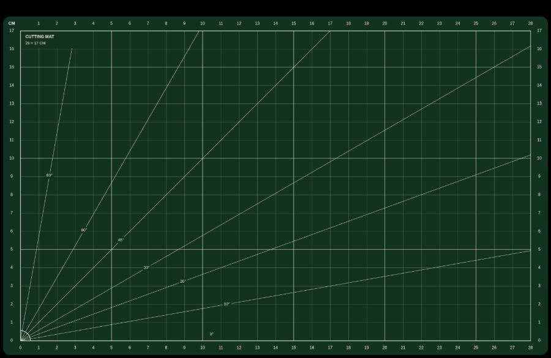
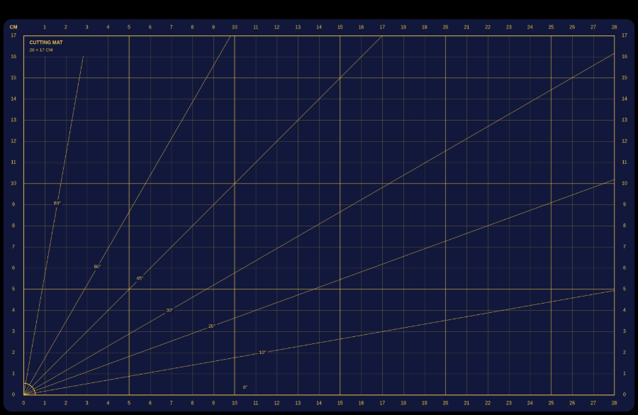
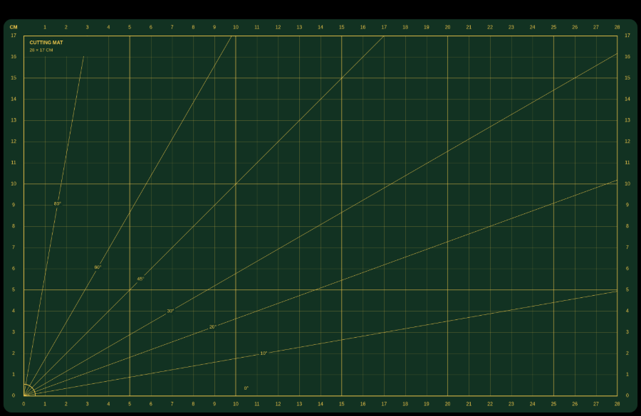

# Cutting Mat

A small Mac menu bar app that gives every connected display a desktop wallpaper shaped like a cutting mat. One grid square is exactly one real centimetre on the screen. Plug in an external monitor and it gets its own wallpaper, at its own resolution and pixel density.

Colours are random: navy or green mat, cream or yellow lines. A display keeps its palette until the set of displays changes.

## Examples

Wallpapers for a 14-inch MacBook Pro. Each one is drawn at the screen's real pixel density, so a grid square measures 1 cm.

| | |
|---|---|
|  |  |
|  |  |

## Download

**[Download CuttingMat.dmg](https://github.com/louis-badr/CuttingMat/releases/latest/download/CuttingMat.dmg)**

1. Open the DMG and drag **Cutting Mat** onto **Applications**.
2. Open it from Applications. The first time, macOS may refuse because the app is not notarized: right-click it, choose **Open**, then **Open** again. If it says the app is damaged, run `xattr -dr com.apple.quarantine /Applications/CuttingMat.app` once.
3. A grid icon appears in the menu bar. From then on the app starts by itself at every login.

No release yet? Open the repo's **Actions** tab, pick the latest successful run and download the `CuttingMat-dmg` artifact. Or build it yourself (below).

## Menu bar icon

- **New random palette**, **Palette** (pick one or random), **Show Wallpapers in Finder**
- **Hide Menu Bar Icon…**: the app keeps running without an icon. Open Cutting Mat again from Applications or Spotlight to get a dialog with **Show Menu Bar Icon** (or Quit).
- **Launch at Login** (on by default once the app is in Applications)

For the wallpaper to be true to scale, keep your displays at their default resolution.

## Build it yourself

Needs a Mac with the Xcode command line tools (`xcode-select --install`):

    ./mac/build.sh

The result is `mac/dist/CuttingMat.dmg`. Every push to `main` is built by a GitHub Action, which replaces the single `latest` release with the new DMG.

## How it works

The app listens for display changes, reads each display's pixel size, physical size and menu bar height, and draws the wallpaper with a small JavaScript engine (`js/`) in a hidden web view. It saves the PNG in `~/Library/Application Support/CuttingMat/wallpapers` and sets it in Fill mode. The 1 cm lines are fine and faint; a normal, heavier line marks every 5 cm, or every 10 cm on large screens (24 inches and up). The same engine powers a separate website version, which is not part of this repo.

- `mac/Sources`: the Swift app
- `mac/Resources`: Info.plist, icon, and the bridge to the engine
- `js/`: `devices.js` (screen presets), `draw-mat.js` (layout and drawing), `render.js` (palettes and entry point)

## License

[MIT](LICENSE)
